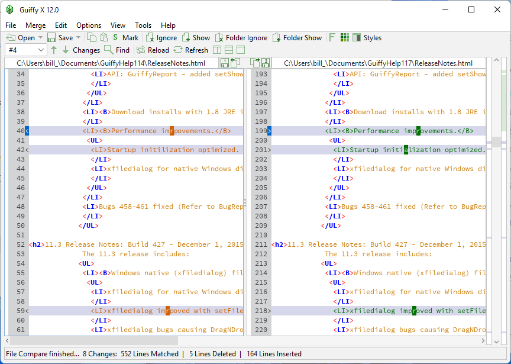
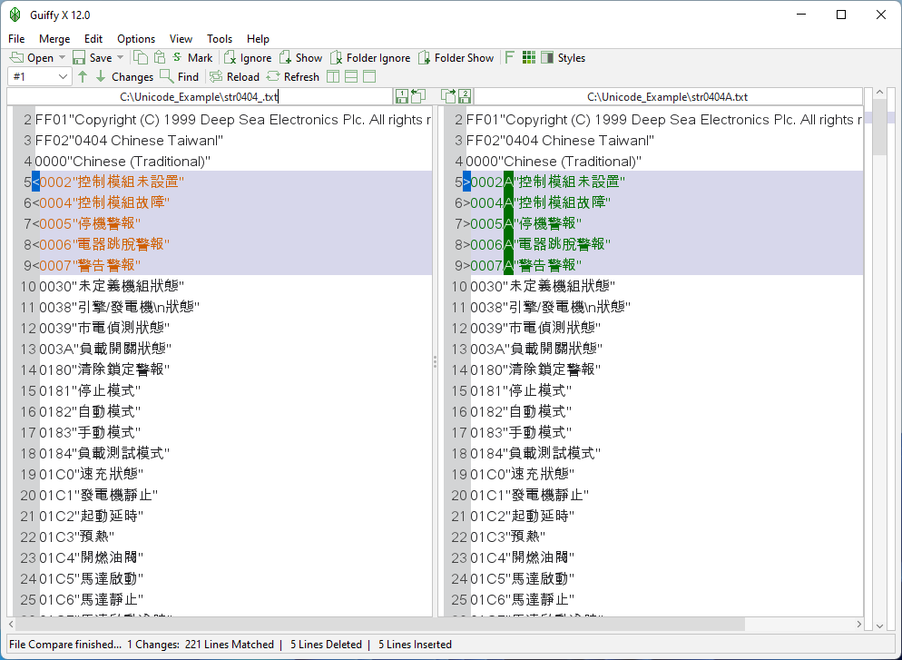

# Guiffy File Comparison and SureMerge Review Guide

Guiffy Suremerge combines visual comparison with three-way merging for source files and other text.
Guiffy also compares folder trees and provides command line integration with development workflows.
This guide explains guiffy file compare, guiffy folder compare, and guiffy visual diff through practical review tasks.

Guiffy Software, Inc. develops the application.
This independent guide includes selected Meld files as reference material from another comparison tool.

[](https://guiffy-suremerge.github.io/Guiffy/)

## What Can Guiffy Do?

Guiffy presents file differences visually and supports navigation between changed regions.
SureMerge uses two modified versions and their common parent to construct a merge result.

| Task | Relevant capability | What to verify |
| --- | --- | --- |
| Review a source revision | File comparison with inline differences | Which lines and characters changed |
| Compare project copies | Recursive folder comparison | Missing, added, and changed entries |
| Resolve parallel edits | SureMerge three-way merge | Parent selection and unresolved Attentions |
| Inspect mixed text encodings | Encoding selection and detection | Characters remain readable on every side |
| Review packaged resources | Supported archive comparison | Archive contents included in the review |
| Share comparison findings | HTML reports | Active ignore rules and input versions |
| Integrate with version control | Git difftool and mergetool support | Executable discovery and argument ordering |

SureMerge is included with Guiffy eXpert.
Confirm the license associated with an existing installation before depending on merge functionality.

The [file comparison overview](https://www.guiffy.com/Diff-Tool.html) describes syntax highlighting, encoding support, and reports.
The [merge overview](https://www.guiffy.com/Merge-Tool.html) explains SureMerge and its attention markers.



For a focused review:

1. Identify the reference revision.
2. Select the modified copy.
3. Inspect encoding and ignore settings.
4. Review each changed region in context.
5. Record the result before applying further edits.

The included Meld tests provide separate examples of comparison behavior:

- [test_matchers.py](test/test_matchers.py) checks matching blocks produced by Meld's sequence matcher.
- [test_filters.py](test/test_filters.py) checks filename filter patterns.
- [test_buffer_lines.py](test/test_buffer_lines.py) exercises text buffer line access.
- [test_filediff.py](test/test_filediff.py) includes cases for removing ignored text ranges.

These are Meld tests.
They neither implement nor validate Guiffy's comparison algorithms.

## Requirements

Guiffy provides packages for Windows, macOS, Linux, and Unix environments.
Check the chosen package against the operating system, architecture, and Java runtime requirements.

Packages with a bundled Java runtime and packages using an external runtime are different deployment choices.
Use the publisher's download information to identify which package you have.

Guiffy Software announced that the company will close and all its products will reach end of life on December 31, 2026.
That announcement should inform any plan for continued use or a new deployment.

The [official homepage](https://www.guiffy.com/) publishes the lifecycle announcement.
Keep the installed version, license details, and required runtime documented with your workflow.

## Running

Guiffy's launcher accepts two file paths for a comparison.
For a three-way merge, place the two modified files before the common parent and the result path.

The following Bash example assumes the installed guiffy launcher is available on PATH.
Replace the review directory with an existing directory containing the input files.

```bash
review_root="$HOME/guiffy-review"
guiffy -u "$review_root/baseline.txt" "$review_root/candidate.txt"
guiffy -u -s "$review_root/ours.txt" "$review_root/theirs.txt" "$review_root/base.txt" "$review_root/result.txt"
```

The -u option ignores saved user settings and must be the first option.
The -s option opens SureMerge with the supplied parent.
The result path identifies the intended merge output.

Inspect unresolved Attentions and review the final text before saving.
Opening the merge does not establish that the combined result is correct.

Windows installations use guiffy.exe rather than the Unix launcher shown above.
See the [Guiffy command line reference](https://www.guiffy.com/help/GuiffyHelp/GuiffyCmd.html) for platform details and exit codes.

Comparable Meld references cover editing and directory comparison:

- [test_chunk_actions.py](test/test_chunk_actions.py) checks chunk handling with different newline formats.
- [test_iohelpers.py](test/test_iohelpers.py) checks shared-parent and relative-path helpers.
- [test_files_same.py](test/dirdiff/test_files_same.py) exercises directory comparison equality decisions.
- [test_remove_blank_lines.py](test/dirdiff/test_remove_blank_lines.py) checks blank-line removal behavior.

## Folder Structure

The included source snapshot contains selected Meld tests, settings, and interface resources.
It is a partial reference collection rather than a complete buildable Meld checkout.
Guiffy source code is not included.

| Reference area | Purpose in this guide |
| --- | --- |
| Comparison tests | Illustrate cases a diff tool must handle |
| Settings schema | Show how another application declares preferences |
| Style schemes | Examine visual roles for changes and conflicts |
| Desktop metadata | Distinguish launcher integration from comparison logic |
| Build metadata | Identify dependencies of the reference project |

Settings and appearance references:

- [org.gnome.Meld.gschema.xml](data/org.gnome.Meld.gschema.xml) declares Meld settings and enumerated choices.
- [meld-dark.style-scheme.xml.in](data/styles/meld-dark.style-scheme.xml.in) defines dark comparison highlighting.
- [meld-base.style-scheme.xml.in](data/styles/meld-base.style-scheme.xml.in) defines base comparison highlighting.

These XML resources use Meld's formats.
They are not Guiffy themes or preference files.

## Developing

Git includes a Guiffy integration script for visual comparison and merging.
The script is part of Git; it is not Guiffy's application source.

The following original Git configuration selects Guiffy while preserving merge backups and prompting before merge tool launches.
It assumes a Git version with built-in Guiffy support and a discoverable Guiffy executable.

```ini
[diff]
    tool = guiffy
[merge]
    tool = guiffy
[mergetool]
    keepBackup = true
    prompt = true
```

These are Git configuration entries, not Guiffy application settings.
Executable lookup must work in the environment where Git launches the tool.

Consult the [publisher's Git integration guide](https://www.guiffy.com/help/GuiffyHelp/Git.html) and [Git's integration script](https://github.com/git/git/blob/master/mergetools/guiffy).
The [Git mergetool reference](https://git-scm.com/docs/git-mergetool) describes backup and prompt settings.

The Meld snapshot illustrates desktop integration and file association separately:

- [org.gnome.Meld.desktop.in.in](data/org.gnome.Meld.desktop.in.in) declares the desktop launcher.
- [org.gnome.Meld.xml.in](data/mime/org.gnome.Meld.xml.in) describes the Meld comparison file association.

## Documentation

Folder comparison can reveal differences without determining which side should replace the other.
Choose a synchronization direction only after inspecting changed and missing entries.

For a repeatable folder review, record:

- Both input folder locations.
- Whether subfolders are included.
- Archive handling settings.
- Filename exclusions and text ignore rules.
- Proposed copy, replacement, and deletion actions.
- The report location and review date.



The [folder comparison overview](https://www.guiffy.com/Folder-Compare.html) describes recursion, archives, and synchronization operations.
For reports, include the comparison settings so another reviewer can understand what was excluded.

The [online help directory](https://www.guiffy.com/hthelp.html) links the GUI launcher, standalone SureMerge, and report command documentation.
Check which executable a command example targets before adapting it.

## Contributing

Useful corrections to this independent guide include reproducible comparison cases and updated documentation links.
Include the operating system, Guiffy version, license edition, input encodings, and relevant settings.

Additional Meld reference files cover localization and build metadata:

- [style-scheme.its](gettext/its/style-scheme.its) identifies translatable style scheme fields.
- [meson.build](meson.build) declares Meld's project and build dependencies.
- [pyproject.toml](pyproject.toml) records Python packaging metadata and build requirements.

Their dependencies belong to Meld.
They do not establish Guiffy's runtime requirements.

## Contact

Use Guiffy Software's published contact information for product and licensing questions while those channels remain available.
For this guide, identify the affected paragraph, command, or reference link.

## Related Search Terms

Guiffy Suremerge, Guiffy, guiffy file compare, guiffy folder compare, guiffy visual diff, compare-files, diff, text-diff, merge, editor, git, file-comparison, directory-comparison, cross-platform, synchronization
